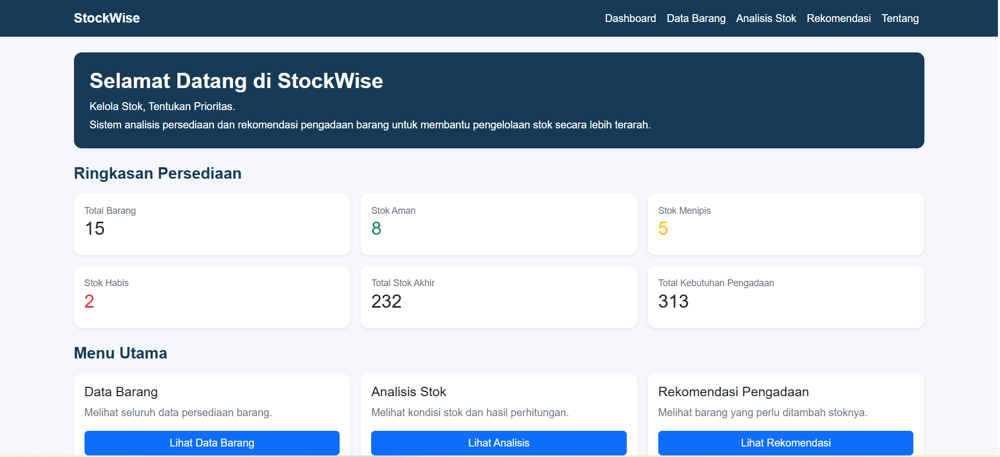
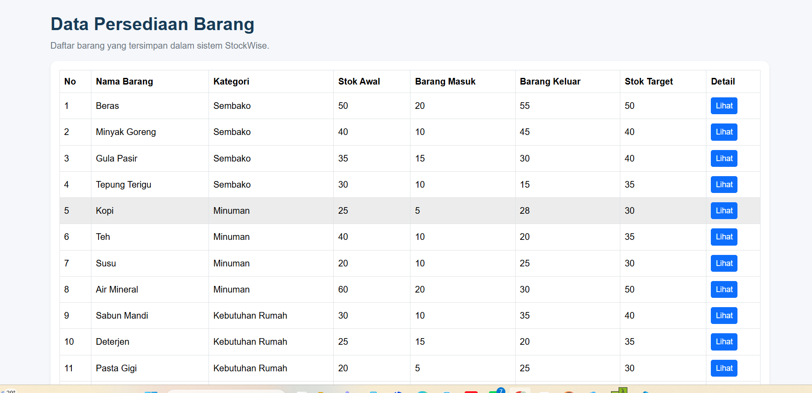
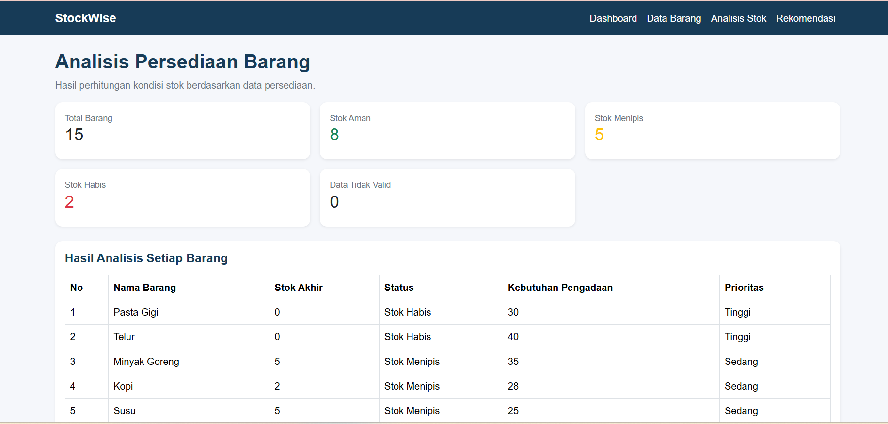
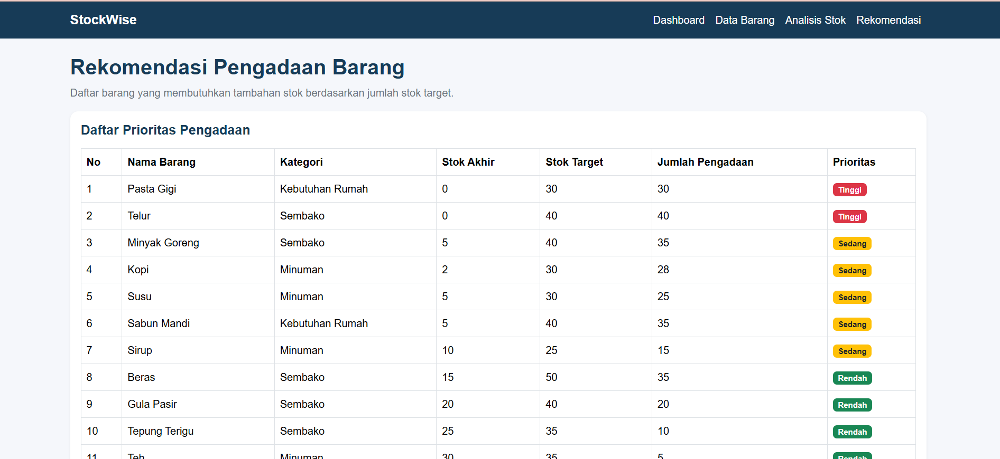

StockWise
Kelola Stok, Tentukan Prioritas

Deskripsi
StockWise merupakan aplikasi berbasis web yang dibuat menggunakan framework Laravel untuk membantu pengelolaan dan analisis persediaan barang. Aplikasi ini digunakan untuk memantau jumlah stok, mengetahui kondisi persediaan, serta memberikan rekomendasi pengadaan barang berdasarkan kebutuhan.

Identitas Pengembang
| Keterangan | Data |
|---|---|
| Nama | Desi Nuryani |
| NIM | C2483207006 |
| Kelas | PT15A |
| Program Studi | Pendidikan Teknologi Informasi |
| Universitas | Universitas Muhammadiyah Tasikmalaya |

Tema Proyek
Tema 3: Sistem Analisis Persediaan dan Rekomendasi Pengadaan Barang.

Latar Belakang
Pengelolaan persediaan barang merupakan hal penting agar kebutuhan barang tetap terpenuhi. Permasalahan yang sering terjadi adalah stok barang yang menipis, habis, atau jumlah persediaan yang tidak sesuai dengan kebutuhan.

StockWise dibuat sebagai solusi sederhana untuk membantu pengguna mengetahui kondisi stok dan menentukan barang yang perlu diprioritaskan untuk pengadaan.

Tujuan Aplikasi
1. Mempermudah pemantauan persediaan barang.
2. Mengetahui kondisi stok setiap barang.
3. Mengelompokkan barang berdasarkan kondisi persediaannya.
4. Menghitung kebutuhan pengadaan barang.
5. Menentukan prioritas pengadaan barang.

Fitur Aplikasi
- Dashboard: Menampilkan ringkasan jumlah barang, stok aman, stok menipis, stok habis, dan total persediaan.
- Data Barang: Menampilkan daftar barang beserta kategori dan informasi stok.
- Kategori Barang: Menampilkan barang berdasarkan kategori.
- Detail Barang: Menampilkan informasi persediaan setiap barang.
- Analisis Stok: Mengelompokkan barang menjadi stok aman, menipis, habis, dan data tidak valid.
- Rekomendasi Pengadaan: Menampilkan jumlah kebutuhan pengadaan dan prioritas barang.

Data dan Perhitungan
Aplikasi menggunakan 15 data barang yang terbagi ke dalam 3 kategori, yaitu:
- Sembako
- Minuman
- Kebutuhan Rumah

Perhitungan stok akhir menggunakan rumus:

Stok Akhir = Stok Awal + Barang Masuk - Barang Keluar

Kebutuhan pengadaan dihitung berdasarkan selisih antara target stok dan stok akhir. Barang yang membutuhkan pengadaan kemudian dikelompokkan berdasarkan prioritasnya.

Teknologi yang Digunakan
- PHP
- Laravel
- Blade Template
- HTML
- CSS

Konsep MVC
Aplikasi StockWise menerapkan konsep MVC (Model, View, Controller):

1. **Model/Data:** Data barang disimpan menggunakan array PHP pada `app/Data/BarangData.php`.
2. **View:** Tampilan aplikasi dibuat menggunakan Blade Template pada folder `resources/views`.
3. **Controller:** Mengatur proses pengambilan data, perhitungan analisis, dan menampilkan hasil ke halaman aplikasi.

Database
Aplikasi StockWise tidak menggunakan database. Seluruh data barang disimpan dalam bentuk array PHP sehingga aplikasi dapat menjalankan proses analisis tanpa koneksi MySQL.

Tampilan Aplikasi

1. Dashboard


2. Data Barang


3. Analisis Stok


4. Rekomendasi Pengadaan


Cara Menjalankan Aplikasi

1. Clone repository:
   ```bash
   git clone URL_REPOSITORY
   ```

2. Masuk ke folder proyek:
   ```bash
   cd stockwise
   ```

3. Install dependency:
   ```bash
   composer install
   ```

4. Salin file `.env.example` menjadi `.env`.

5. Jalankan aplikasi:
   ```bash
   php artisan serve
   ```

6. Buka browser dan akses:
   ```text
   http://127.0.0.1:8000
   ```
